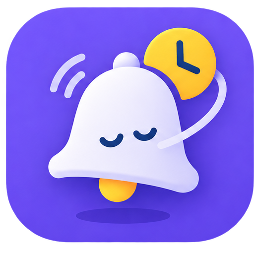
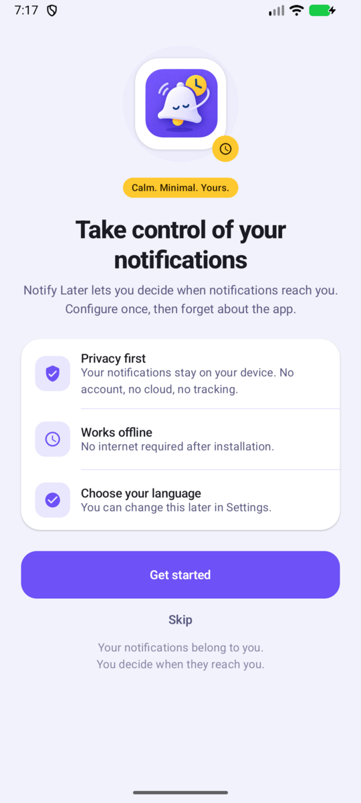
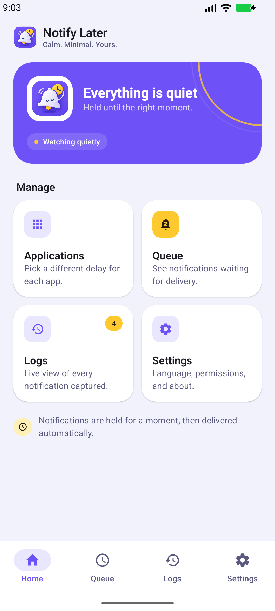
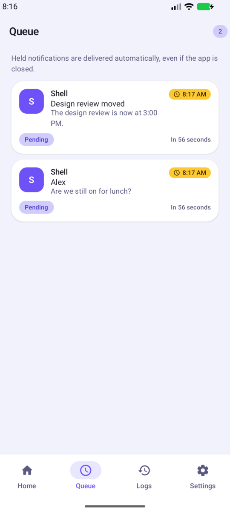
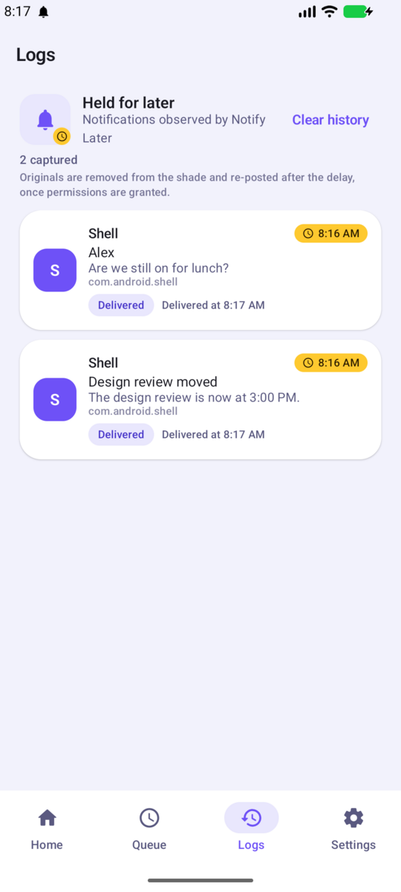
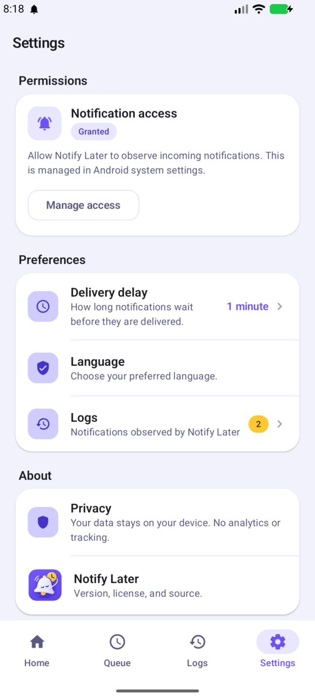
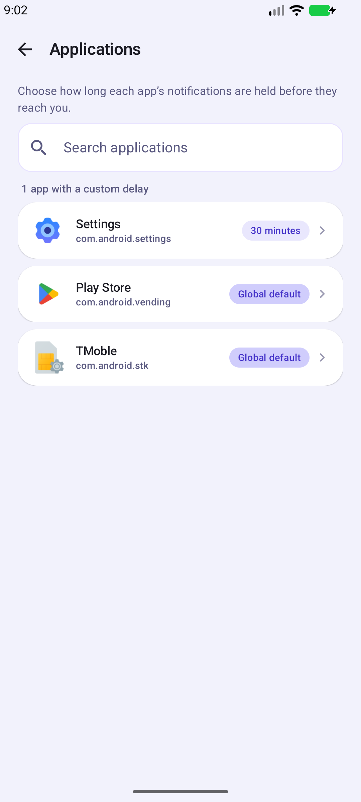

<p align="center">
  
</p>

<h1 align="center">Notify Later</h1>

<p align="center">
  <strong>Your notifications belong to you.<br/>You decide when they reach you.</strong>
</p>

<p align="center">
  <em>As suas notificações pertencem a si.<br/>Você decide quando elas chegam.</em>
</p>

<p align="center">
  <a href="https://github.com/noejunior299/notify-later"></a>
  <a href="LICENSE"></a>
  
</p>

---

## What is Notify Later?

Notify Later is an open-source, privacy-first, local-first Android application that lets you decide **when** notifications from other apps should reach you.

Instead of every app dictating when it gets your attention, you configure rules once — then forget about the app. Notifications are held and delivered on your schedule.

> **Configure your notification rules once, then forget about the app.**

Notify Later should feel **calm, minimal, trustworthy, and native to Android**.

## Why Does Notify Later Exist?

- Applications compete for attention by sending notifications at any time.
- Constant interruptions fragment focus, increase anxiety, and erode control.
- Existing tools either require cloud accounts, show ads, or harvest notification content.

Notify Later gives control back to the user:

- No backend required for core functionality
- No account system
- No ads, no analytics, no telemetry in the MVP
- Data stays on your device

See [Vision](docs/product/vision.md) and [Principles](docs/product/principles.md).

## Core Principles

| Principle | Meaning |
|-----------|---------|
| **Privacy First** | Notification content may be sensitive. Everything stays local. |
| **Local First** | Works offline after installation. No cloud dependency for MVP. |
| **Open Source** | Public, auditable, easy to build and contribute. |
| **User Control** | You decide when you are interrupted, not the apps. |
| **No Dark Patterns** | No manipulation into permissions, tracking, or payments. |
| **Calm UI** | The app itself must not become another distraction. |

Full details: [docs/product/principles.md](docs/product/principles.md)

## Current Status

```
🚧 Early development — notification delay MVP working
```

- Android app built with Jetpack Compose + Material 3, available in English and Portuguese.
- The notification listener captures new notifications, persists them locally, cancels the original, and re-delivers it after the delay configured in Settings.
- Queue and Logs show pending and delivered notifications; Settings handles notification access, posting permission, and the global delay.
- Applications lists the launchable apps so each one can get its own delay (for example WhatsApp 30 minutes, Facebook 1 hour); apps without a rule follow the global delay.
- Batching, quiet hours, and custom schedules are **not implemented yet**; delays are limited to the offered presets.
- Contributions to rules, reliability, testing, and documentation are welcome.

See [Roadmap](docs/product/roadmap.md).

## Supported Platforms

| Platform | Language | Status |
|----------|----------|--------|
| **Android** | Kotlin | 🚧 Active — first platform |
| **iOS** | Swift / SwiftUI | 📋 Planned — no implementation yet |

The repository is structured to allow a future `ios/` implementation sharing product concepts but using platform-native code. No Kotlin Multiplatform is forced at this stage.

## Screenshots

<p align="center">
  
  
  
</p>

<p align="center">
  
  
  
</p>

<p align="center"><em>Debug build on Android, English, light theme. The interface is also available in Portuguese and in dark theme.</em></p>

Design direction: minimal, calm, spacious, accessible, native Android, low visual noise. See [Design](docs/product/design.md).

## Internationalization

Notify Later ships with two languages from day one:

- **English** (default / fallback) — `res/values/strings.xml`
- **Português** (Brazilian / neutral Portuguese) — `res/values-pt/strings.xml`

Language is selectable during onboarding and in Settings. No user-facing strings are hard-coded in Kotlin. See [docs/android/architecture.md](docs/android/architecture.md#internationalization).

## Development

### Requirements

- JDK 17
- Android Studio Hedgehog or newer
- Android SDK Platform 37, Build Tools, and compatible NDK if needed
- Git

### Clone and Build

```bash
git clone https://github.com/noejunior299/notify-later.git
cd notify-later/android
./gradlew assembleDebug
./gradlew testDebugUnitTest
```

Open `android/` in Android Studio and run on an emulator or device (`minSdk 29`).

Detailed guide: [docs/contributing/getting-started.md](docs/contributing/getting-started.md) and [docs/android/development.md](docs/android/development.md)

### Project Structure

```
notify-later/
├── android/                 # Android application (Kotlin + Compose + Material 3)
│   └── app/src/main/java/ao/techify/notifylater/
│       ├── core/            # database, notifications, permissions, scheduler, settings
│       ├── data/            # local, model, repository
│       ├── domain/          # model, repository, usecase
│       ├── feature/         # onboarding, home, applications, rules, queue, settings
│       └── navigation/      # navigation graph
├── docs/                    # product, architecture, android, contributing
├── .github/                 # issue templates, workflows, code of conduct
└── README.md
```

Architecture: [docs/architecture/overview.md](docs/architecture/overview.md) · [docs/android/architecture.md](docs/android/architecture.md)

## Contributing

Contributions are welcome! Start here:

1. Read [CONTRIBUTING.md](CONTRIBUTING.md)
2. Read [docs/contributing/getting-started.md](docs/contributing/getting-started.md)
3. Pick an issue or open one using the templates
4. Keep changes focused; run `./gradlew testDebugUnitTest` before opening a PR

Work lives in `android/`; product and architecture docs live in `docs/`.

## Roadmap

- **Phase 0 — Foundation** — repo, architecture, docs, localization, CI ✓ _complete_
- **Phase 1 — Notification Capture** — `NotificationListenerService`, persistence ✓ _implemented; app detection pending_
- **Phase 2 — Delay Engine** — queue, WorkManager scheduler, renderer ✓ _MVP implemented, including per-app delays_
- **Phase 3 — User Experience** — onboarding, history, settings ✓ _in progress; app management implemented, custom schedules pending_
- **Phase 4 — Reliability** — battery, permissions, resilience, a11y, tests
- **Phase 5 — Community** — beta, translations, feedback
- **Future** — iOS, advanced rules, profiles

Full roadmap: [docs/product/roadmap.md](docs/product/roadmap.md)

Conceptual pipeline: [docs/architecture/notification-pipeline.md](docs/architecture/notification-pipeline.md)

## Privacy

- Local-first: core features work offline, no backend, no account.
- No analytics, no telemetry, no ads in the MVP.
- Notification content stays on-device.
- Permissions are requested only when needed and explained clearly.

Security disclosures: see [SECURITY.md](SECURITY.md). **Do not file public issues for security vulnerabilities.**

## Support Notify Later

Notify Later is free and open source.

If you find the project useful, you can support its development.

Your support can help with:

- development
- testing
- accessibility
- documentation
- developer accounts
- infrastructure when necessary
- acquiring the official notifylater.com domain

Sponsorship placeholders (to be updated when accounts are ready):

- [GitHub Sponsors](#)
- [Buy Me a Coffee](#)

No payments or subscriptions are inside the application itself.

## Domain

The official domain may eventually become `notifylater.com`, but it is not currently owned by the project and is **not a technical dependency**. The canonical location is:

```
https://github.com/noejunior299/notify-later
```

## License

[Apache License 2.0](LICENSE) — see `LICENSE` for details.

Copyright 2026 Notify Later Contributors.
